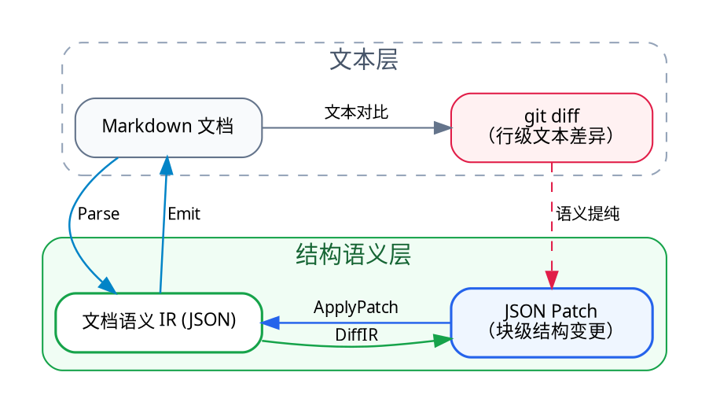

# Markdown IR 项目架构（`markdown-ir`）

本文描述项目目标、模块边界、数据承载方式、处理流程与实施阶段。Markdown 语法如何映射为抽象 IR、内容等价及语义变化的具体规则，统一见 [Markdown 语法与 IR 语义映射](./markdown-ir-semantics.md)。

背景与目标：Markdown 文档的修改在文本层通常由 `git diff` 表达，但基于行的文本 diff 缺乏文档结构语义（无法区分纯排版噪音与真实语义修改，也无法表达“移动某个列表项”“修改某级标题属性”等结构操作）。为此，我们设计一套引擎无关、支持多 Markdown 方言扩展的「Markdown 语义 IR」并用 JSON 表示；借此将静态的 Markdown 文档映射为结构化 JSON 树，进而用「JSON Patch」精确表达与操作 Markdown 改动的结构语义，实现全量与增量的双向语义同步。

## 1. 总体需求与核心不变量

IR 从 Markdown 语法中抽象出文档内容及其组织关系，为结构化编辑与语义 Diff 提供一致的表示。Markdown 与 IR 往返须保持本规范约定的内容语义；表达相同语义的不同写法应归并为相同的 IR 内容表示，不产生语义 Diff。具体节点及等价规则见[语义映射文档](./markdown-ir-semantics.md)。

### 1.1 核心推导逻辑与双向链路

整个系统的设计源于从「文本层」到「结构语义层」的对偶推导：

1. 痛点（`git diff` 语义不足）：人在修改 Markdown 时，文本层只能产生基于行的 `git diff`。无论是增删空行、列表符号从 `*` 改为 `-`，还是移动整段章节，在 `git diff` 中都只是扁平的文本行增删，缺少“改了哪个文档块、做了什么结构变更”的语义。
2. 静态结构化（`Markdown ⇄ IR JSON`）：为了补齐结构语义，我们将 Markdown 解析映射为引擎无关的文档语义 IR，并以 JSON 树承载（每个块级节点拥有稳定 `id` 与固定字段外壳）。
3. 动态变更结构化（`git diff ⇄ JSON Patch`）：一旦文档由 IR JSON 表示，文档的修改就自然转化为 IR 树上的 JSON Patch——既能从人改前后的 Markdown 中提纯出无排版噪音的结构化 JSON Patch，也能直接把 JSON Patch 应用到 IR 上并写回 Markdown。



系统围绕这两层建立两条双向链路：

- 全量双向链路（静态文档互转，`Markdown ⇄ IR JSON`）：
  - 正向（`IR → Markdown`）：合法规范的文档语义 IR 经 `Adapter.Emit`（阶段 2）渲染为规范风格的 Markdown 文本，默认保持纯净规范 Markdown（配合隐藏 `IR_old` 快照无感继承块身份，仅按需在关键块显式落盘锚点）供人阅读和编辑。
  - 反向（`Markdown → IR`）：人修改 Markdown（改字、调整结构、新增段落、手写任意 Markdown 语法）后，经 `Adapter.Parse`（阶段 2）解析并剥离底层引擎私有 AST、还原块 `id`，再由阶段 1 内核 `Normalize` / `Verify` 产出标准语义 IR。
- 增量双向链路（动态改动互转，`git diff ⇄ JSON Patch`）：
  - 人改 Markdown → 提取 JSON Patch：`DiffIR(IR_old, IR_new)` 在 IR 层对比编辑前后的文档树，过滤空行/缩进等纯排版噪音，将原本粗糙的文本 `git diff` 提纯为基于块 `id` 寻址的 JSON Patch。
  - 应用 JSON Patch → 局部更新 Markdown：`ApplyPatch(IR_old, Patch)` 在 IR 树上直接执行块级增删改移补丁，并支持按源码区间 `pos` 局部重印 Markdown。

### 1.2 全链路上的模块

1. 纯 IR 校验、规范化与升级内核（`ir`）
   - 输入 → 输出：`任意 IR JSON` → `合法规范化 IR / Error`
   - 核心职责：定义 IR 数据结构、版本升级（`AutoUpgrade`）、Schema 与嵌套约束校验（`Verify`）、保持语义的规范化（`Normalize`）
2. Markdown → IR 解析器（`Parse`）
   - 输入 → 输出：`Markdown (+ 可选 IR_old)` → `IR + Diagnostics`
   - 核心职责：解析 Markdown、剥离引擎私有结构、绑定块 `id`、捕获超纲构造进 `raw_*`
3. IR → Markdown 生成器（`Emit`）
   - 输入 → 输出：`IR` → `Markdown`
   - 核心职责：按规范形式写出 Markdown 文本；默认保持纯净规范 Markdown（配合隐藏 `IR_old` 快照无感继承块身份），仅按需在关键块显式落盘身份锚点
4. IR 差分生成器（`DiffIR`）
   - 输入 → 输出：`(IR_old, IR_new)` → `Patch`
   - 核心职责：将修改 Markdown 产生的新旧 IR 状态提纯为结构化 Patch，过滤纯排版噪音
5. IR 补丁应用器（`ApplyPatch`）
   - 输入 → 输出：`IR_old + Patch` → `IR_new (+ Markdown)`
   - 核心职责：在 IR 上执行增删改移补丁，支持局部更新 Markdown

### 1.3 不变量

1. 语义往返与输出稳定：在固定的方言与输出配置下，对能够由目标 Markdown 无损表达其内容的合法 IR `x`，若人不介入编辑，重新解析输出文本后必须保持本规范约定的内容语义；规范输出应满足 `emit(parse(emit(x))) == emit(x)`。往返不以整棵 IR 的全部字段相等或原始 Markdown 字节相等为判据；身份和附加信息仍需按各自规则保留。内容比较的精确字段范围与保留条件将在语义合同复审中逐项补齐。
2. 身份存活（Identity Preservation）：修改某块的文本或移动块位置不应改变该块的 `id`；新增块应能被识别为无原身份的新块。
3. 无静默丢失（No Silent Loss）：人手写的超纲 Markdown 构造，或高版本/未启用方言中的未知节点与属性，回读和保存时不得被静默丢弃——必须装入逃生舱节点或属性字典原样保留。
4. 引擎无关（Engine Agnosticism）：IR 数据结构中不得出现任何特定 Markdown 引擎的私有概念；切换底层引擎不修改 IR 数据定义。
5. 方言可扩展（Dialect Extensibility）：以 CommonMark 作为基础公共核，支持按需注册并扩展各类 Markdown 方言（如 GFM、数学公式、双链笔记、Callout/容器指令等）的块级与行内节点；扩展新方言不改变 `Node` 物理外壳，且支持跨方言 `fallback` 降级与 `raw_*` 保底。

### 1.4 语义基准与文档分工

项目以 [CommonMark 0.31.2](https://spec.commonmark.org/0.31.2/) 为解析与基础结构的基准，在此基础上定义文档内容及其组织关系。核心 IR 独立于具体解析引擎，方言通过扩展机制接入。

架构文档定义各模块如何协作；[语义映射文档](./markdown-ir-semantics.md)定义内容单元是什么、Markdown 结构对应哪些 IR 表示，以及哪些变化具有语义。Parse、Emit、Normalize、Verify 和 DiffIR 共同遵守这些规则。

IR 的语义合法性与目标 Markdown 的可表达性分别判断。节点与等价规则先确定，再据此设计解析、规范化和输出。尚未收敛的问题和候选方案分别保留在[本文 §5](#5-待决策的架构合同与候选方案)与[语义映射文档 §6](./markdown-ir-semantics.md#6-待继续定义的语义与映射)，均保持待决策状态。

## 2. 架构分层

借鉴编译器（LLVM / MLIR）以 IR 为中心与多方言（Dialect）的设计思想，系统将「纯 IR 数据结构、方言扩展机制与校验规范化规则（内圈核心）」与「具体的 Markdown 解析引擎及增量工具（外圈适配）」解耦，按由内向外的顺序分为三个阶段推进。

目前「阶段 1：纯 IR 数据定义」已形成基础数据模型，语义合同正在逐项复审；已确认以本规范约定的内容语义一致作为往返目标。阶段 2～3 尚未经过深入讨论，当前仅保留前期调研的方向性构想，留待阶段 1 落地后再逐阶段展开具体设计：

1. 阶段 1（内圈）：纯 IR 数据结构定义与内核规则（见 §2.1）
   - 定位与范围：完全不感知具体 Markdown 解析引擎的语法细节；定义节点物理外壳、根节点 `"markdown-ir"` 版本头、基础核节点与方言（Dialect）扩展机制、块 `id` 归属边界、以及纯 IR 树的校验（`Verify`）、规范化（`Normalize`）与版本升级（`AutoUpgrade`）。
   - 当前设计成熟度：基础数据模型已形成；语义等价、规范化与信息保留合同正在逐项复审，尚未全部锁定。
2. 阶段 2（外圈）：Markdown 引擎适配与文本转换（见 §2.2）
   - 定位与范围：将 lute、goldmark 等作为可替换适配器站在外圈，负责 `Parse` / `Emit`、各 Markdown 方言语法与 IR 节点的双向映射、Markdown 文本中 `{: id="..."}` 与 `meta` 的落点细节、转义与格式化规则。
   - 当前设计成熟度：📝 仅完成前期粗浅调研（方向初探，尚未具体讨论定稿）。
3. 阶段 3（外圈）：增量 Diff / Patch 算子（见 §2.3）
   - 定位与范围：在 IR 层实现 `DiffIR` / `ApplyPatch`、ID 寻址补丁具体结构、以及按 `pos` 局部重印策略。
   - 当前设计成熟度：📝 仅完成前期粗浅调研（方向初探，尚未具体讨论定稿）。

---

### 2.1 纯 IR 数据结构规范

#### 2.1.1 节点物理外壳（Node Envelope）—— MLIR `Operation` 式固定结构

设计决策：固定顶层槽位 + `attrs` 开放字典

节点专有属性（如标题的 `depth`、链接的 `url`、列表的 `ordered`）不散落在节点顶层，而是统一收敛进 `attrs` 字典。整棵 IR 树中的任何节点永远只使用以下固定的顶层系统键：

```json
{
  "markdown-ir": "0.0.1",
  "id": "20261029-doc01",
  "type": "doc",
  "meta": {},
  "children": [ ... ]
}
```

Go 核心结构体定义：

```go
type Node struct {
    Version  string         `json:"markdown-ir,omitempty"` // 仅根节点 type=="doc" 必填，格式魔数兼 SemVer 版本号，如 "0.0.1"
    ID       string         `json:"id,omitempty"`          // 块级节点稳定身份（行内节点禁止出现）
    Type     string         `json:"type"`                  // 节点类型操作码
    Attrs    map[string]any `json:"attrs,omitempty"`       // 节点固有语法属性（Inherent Attrs，由 Verifier 按 Type 校验）
    Value    *string        `json:"value,omitempty"`       // 叶子节点纯文本载荷（仅 text / inline_code / code_block / raw_*）
    Children []*Node        `json:"children,omitempty"`    // 容器节点的有序子节点列表（Regions）
    Meta     map[string]any `json:"meta,omitempty"`        // 附加旁路元数据（Discardable Attrs，跨 Pass 强制透传）
    Fallback []*Node        `json:"fallback,omitempty"`    // 扩展节点或高版本未知节点的降级渲染子树
    Pos      *SourcePos     `json:"pos,omitempty"`         // 可选源码区间 {start, end, lines}，持久化可省略
    Origin   *SourceOrigin  `json:"origin,omitempty"`      // 可选源保真旁路数据，持久化可省略
    Errors   []Diagnostic   `json:"errors,omitempty"`      // 节点级解析/校验诊断信息
}
```

决策原因：
1. 吸收 LLVM 历史教训与 MLIR 终局抽象：早期 LLVM 因将属性写死为固定位掩码、未预留旁路元数据槽，在 LLVM 2.7（补 `Metadata`）、3.3（属性改开放字典 `AttributeList`）、14–17（Opaque Pointers 剥离指针类型外壳）经历了三次底层结构大手术。MLIR 总结该教训后将节点固定为 `{名称, 属性字典, 值, 嵌套区域, 源码位置}` 五元组，此后新增任何方言与语法均只扩展属性字典键值，永不动摇节点外壳。
2. 根治 Go `encoding/json` 静默丢字段隐患：若将节点专有属性平铺在顶层，旧版程序反序列化新版包含新顶层字段的 JSON 时，Go 标准库会静默丢弃未定义字段，违反不变量 #3（无静默丢失）。收敛入 `Attrs: map[string]any` 后，配合顶层 `DisallowUnknownFields()`，既能严格拦截顶层拼写错误，又能无损保留未知属性。
3. `attrs` 与 `meta` 职责正交（对应 MLIR Inherent vs Discardable Attributes）：
   - `attrs`：存放定义节点自身文档语义的固有参数（由 `Verify` 按 `type` 严格校验 schema），如 `depth`、`url`、`ordered` 及 `x-*` 扩展块的结构化参数。
   - `meta`：存放不影响文档核心语法结构的附加自定义属性（如块级自定义标签、注释标记、外部引用属性等），值类型限定为 `string | number | boolean | string[]`。未知 `meta` 键必须跨所有转换 Pass 原样透传保留。
   - 系统保留键规范：键名 `markdown-ir`、`id`、`type`、`attrs`、`value`、`children`、`meta`、`fallback`、`pos`、`origin`、`errors` 及前缀 `_`、`sys:` 归系统保留，禁止写入 `meta`。
4. 顶层 `"markdown-ir": "0.0.1"` 格式头（对齐 OpenAPI / LLVM Module Header）：将协议标识与三段式语义化版本（`MAJOR.MINOR.PATCH`）合二为一置于根对象顶层，使加载器 `LoadIR` 在反序列化整棵树之前即可常数时间识别格式并路由至 `AutoUpgrade` 迁移链。

#### 2.1.2 节点身份（`id`）在数据结构上的归属边界

块与行内的结构归属以本规范的 CommonMark 基础模型及方言 Schema 为准；块级节点具有独立 `id` 是本项目为结构化编辑增加的身份规则。Lute 的块分类可作为适配参考，不代替本规范定义：

- 持有全局唯一 `id` 的节点：
  全部块级节点（Block Nodes，含 `doc` 与 `list_item`，以及 GFM 方言中的 `table`）。
- 严格禁止携带 `id`（`id` 必须为空）的节点：
  全部行内节点（Inline Nodes），以及当前 GFM 扩展规划中不具有独立块身份的 `table_row` 与 `table_cell`；表格内部节点的结构归属由对应方言 Schema 定义。

决策原因：
`list_item` 是独立的块级结构容器（内部可包含多个段落或嵌套子列表）。为在文档增量编辑中独立识别和寻址被移动、重排、增删的列表项，本项目让 `list_item` 自身持有稳定 `id`。此身份规则不依赖某个引擎的 `IsBlock()` 实现。

#### 2.1.3 节点语义与 Schema 的职责

首版 `0.0.1` 以 CommonMark 基础核、原始载荷保留及方言扩展机制为范围；后续通过方言模块逐步支持 GFM、数学公式、脚注和知识库语法。

节点类型、属性、父子约束与内容等价规则统一定义在[语义映射文档](./markdown-ir-semantics.md)。内核以这些定义为依据执行校验和规范化；适配器负责具体语法与 IR 的转换，DiffIR 依据同一套语义规则判断变化。

固定节点外壳负责承载数据，各节点 Schema 负责解释数据的内容含义。具体节点规则的修订在语义映射文档中维护。

#### 2.1.4 Markdown 方言扩展机制（Dialect Architecture）

真实世界中的 Markdown 存在众多方言（如 GFM、Obsidian/思源双链笔记、Pandoc/Quarto 学术写作、MDX/Markdoc 组件指令等）。借鉴 MLIR 的 Dialect（多方言共存）机制，IR 从内核层原生支持方言扩展：

1. 外壳不变，指令可扩展：
   由于 `Node` 物理外壳固定为 `{id, type, attrs, value, children, meta, fallback}`，新增任何 Markdown 方言均不修改 `Node` 结构体，仅需在命名空间 `<dialect>/<op>`（自定义方言使用 `x-<dialect>/<op>`）下定义新节点的 `type` 及其 `attrs` / `children` 约束。
2. 方言的语义定义：
   每个方言声明自己的内容单元、属性及组合规则；具体映射规划见[语义映射文档 §5](./markdown-ir-semantics.md#5-方言映射规划)。
3. 方言注册表（`DialectRegistry`）：
   阶段 1 的 `Verify` 与 `Normalize` 不将节点集合写死为封闭分支，而是支持挂载 `DialectSpec`（声明该方言节点的块/行内归属、`attrs` 字段类型与默认值、允许的 `children` 嵌套类型）。对于已注册的方言节点，按其 Schema 严格校验；对于未注册的 `x-<dialect>/<op>` 节点，校验其基本外壳与 `fallback` 合法性并原样放行。
4. 跨方言无损降级与升格（Graceful Fallback & Promotion）：
   - 向低能力方言降级（`fallback`）：方言节点可携带由基础 CommonMark 节点构成的 `fallback` 子树（例如 `x-wiki/link` 的 `fallback` 为普通 `text` 或标准 `link`），当导出目标不支持该方言时可平滑降级渲染，或输出受控代码块保真。
   - 从未识别语法升格（`raw_* → 方言节点`）：当解析器未开启某方言时，对应语法先无损存入 `raw_block` / `raw_inline`；后续开启该方言时，可通过方言升级 Pass 将其解析升格为强类型方言节点。

#### 2.1.5 纯 IR 树自身的规范化、校验与版本演进规则（Stage 1 内核逻辑）

1. 纯 IR 规范化流水线（`Normalize(doc)`）：
   实现为显式有序的纯函数小 Pass 序列，必须满足收敛性合同 `Normalize(Normalize(x)) == Normalize(x)`：
   - Pass 1（按 Schema 处理字符串）：仅执行当前节点 Schema 明确规定为语义等价的字符串变换，未规定时保留原值；不再统一改写所有 `value` 的换行。源码行尾的解析处理与 IR 字符数据不同：例如 `&#13;` 解码得到的文本字符不能因源码换行归一化规则被改成 `\n`。代码与不透明载荷也不得由通用 Pass 改写。
   - Pass 2（文本归并与空节点清理）：仅对无 `attrs/meta/pos/origin/errors/fallback` 等附加信息的普通 `text`，删除 `value == ""` 的空节点，或合并同一父节点下连续相邻的节点；带附加信息的文本不得通过合并或删除改变其数据及作用范围。清理后须检查父节点的内容约束；如段落或强调容器变空而不合法，Normalize 失败并保留原输入，不能自动删除整个容器。
   - Pass 3（默认值属性剥离）：剥离 `attrs` 中等于默认值的可选字段（如 `list` 的 `ordered:false, start:1, tight:true`；`break` 的 `hard:false`；空 `title` / `info` 以及已注册方言的默认属性），空字典置 `nil`。
2. 双端合法性校验器（`Verify(doc)`）：
   强制校验根信封 `"markdown-ir"` 版本号、块级 `id` 全局唯一性与行内禁 `id`、基础核与已注册方言节点的 `attrs` / `value` / `children` Content Model（含 `link` 禁嵌 `link`、`list` 仅含 `list_item`）、以及 `meta` 系统保留键冲突。
3. 版本升级与前向兼容（`LoadIR` & `AutoUpgrade`）：
   - 向后兼容（旧数据 → 新代码）：入口预检顶层 `"markdown-ir"` 版本号（`MAJOR.MINOR.PATCH`），若低于当前版本，按有序迁移链 `migrations[v -> v_next]` 自动升级 JSON 树。
   - 前向兼容（新数据 → 旧代码）：若遇到同大版本（`MAJOR` 相同）更高小版本中不认识的节点类型，保留其 `fallback` 并将原节点完整 JSON 封入 `raw_block`/`raw_inline`（`attrs: {"format": "ir-unknown"}`），确保写回时不丢失未来版本数据；遇到跨大版本则明确报错拒绝。
   - 版本金样固化：每版本冻结一份覆盖全部节点的 `compatibility-0.0.1.json`，纳入后续版本回归门禁。

#### 2.1.6 完整 JSON 示例

```json
{
  "markdown-ir": "0.0.1",
  "id": "20261029-doc01",
  "type": "doc",
  "children": [
    {
      "id": "20261029-aaaa",
      "type": "heading",
      "attrs": { "depth": 1 },
      "children": [
        { "type": "text", "value": "搜索服务重构评审" }
      ]
    },
    {
      "id": "20261029-bbbb",
      "type": "paragraph",
      "children": [
        { "type": "text", "value": "目标是将核心接口延迟降低 " },
        { "type": "strong", "children": [{ "type": "text", "value": "30%" }] },
        { "type": "text", "value": "，详见 " },
        {
          "type": "x-wiki/link",
          "attrs": { "target": "延迟优化方案", "alias": "优化方案" },
          "fallback": [{ "type": "text", "value": "[[延迟优化方案|优化方案]]" }]
        },
        { "type": "text", "value": "。" }
      ]
    },
    {
      "id": "20261029-cccc",
      "type": "list",
      "children": [
        {
          "id": "20261029-li01",
          "type": "list_item",
          "children": [
            {
              "id": "20261029-p001",
              "type": "paragraph",
              "children": [{ "type": "text", "value": "完成纯 IR 内核" }]
            }
          ]
        }
      ]
    },
    {
      "id": "20261029-dddd",
      "type": "x-callout/block",
      "attrs": { "kind": "note", "title": "注意" },
      "children": [
        {
          "id": "20261029-p002",
          "type": "paragraph",
          "children": [{ "type": "text", "value": "请先完成阶段 1 校验。" }]
        }
      ],
      "fallback": [
        {
          "id": "20261029-fb01",
          "type": "blockquote",
          "children": [
            {
              "id": "20261029-fb02",
              "type": "paragraph",
              "children": [{ "type": "text", "value": "注意：请先完成阶段 1 校验。" }]
            }
          ]
        }
      ]
    }
  ]
}
```

### 2.2 【前期调研构想 · 待深入设计】Markdown 引擎适配与文本转换

> ⚠️ 注意：以下 §2.2 与 §2.3 内容属于前期调研形成的高层方向性草案，尚未逐项设计；§2.1 的基础数据模型已形成，完整语义与规范化合同仍在审查。在阶段 1（纯 IR 内核）完成后，进入对应阶段前需重新展开具体设计评审。

#### 2.2.1 Markdown 文本中的身份锚点与属性表现

- 初步方向：磁盘上的 `.md` 文件默认保持对人类与通用 Agent 100% 友好的纯净规范格式（零视觉污染，不在段落、列表项等普通块上强行写入 `{: id="..."}`）；仅在关键章节标题或特殊 `x-*` 扩展容器块上允许按需显式落盘可选锚点（复用 Lute 原生的 Kramdown Block IAL）。块身份与 `meta` 的常规存活路径改为「旁路快照对齐 + 按需稀疏锚点」：在隐藏元数据区（如 `.git/info/`、同目录隐藏快照文件或数据库）保存上一版本的 `IR_old` JSON，`Parse(Markdown, IR_old)` 通过确定性的树结构与文本指纹对齐算法（参考 mdd `identity.reattach` 的分级匹配——显式锚点优先 → 章节子树 + 文本 SHA-256 指纹精确匹配 → 同父容器下结构位置确定性继承，不做跨结构的不可靠模糊乱猜）在后台自动将 `IR_old` 中的块 `id` 与 `meta` 无感继承给未重构的块，既保住不变量 #2（块身份存活），又实现 `.md` 源码层的零视觉污染（并保留无锚点的 `stateless` 模式供简单导入导出场景使用）。
- 待深入讨论的细节：
  - 确定性树结构与文本指纹对齐的分级匹配规则（显式锚点 → 章节子树 + 文本 SHA-256 指纹 → 同父结构位置继承，各级之间的优先级、加分与短路条件）；
  - 隐藏快照 `IR_old` 的存储落点约定（`.git/info/` vs 同目录隐藏快照文件 vs 数据库，快照与 `.md` 的版本绑定与失效策略；节点 `meta` 与文档级 `doc.meta` 默认随旁路恢复，是否仍需 YAML Frontmatter 承载文档级元数据）；
  - 哪些关键块（如章节标题、特殊 `x-*` 扩展容器块）允许显式落盘可选锚点（含 `{: id="..."}` 写出的精确格式与缩进规则），以及复制粘贴产生重复 ID（`ambiguous`）或手动删改锚点（`unanchored`）时的具体消歧策略。

#### 2.2.2 Markdown 规范化输出（Canonical Emission）与转义

- 初步方向：`Emit` 渲染 Markdown 时应遵循唯一规范形式（如统一用 ATX `#` 标题、`- ` 无序列表、动态长度反引号围栏、`proseWrap: preserve` 保留段落折行、最小化上下文敏感转义），以保证 `emit(parse(emit(x))) == emit(x)`。
- 待深入讨论的细节：
  - `Emit` 是直接基于 IR 树编写独立的公共 Printer，还是复用 Lute 的 `FormatNodeSync`（在适配器中补齐 Marker 节点）；
  - `normalising`（强制规范化输出）与 `preserving`（未修改块按 `origin.raw_bytes` 原样回放）两种模式的切换边界。

#### 2.2.3 方言语法适配与逃生舱表现

- 初步方向：
  - 方言插件化转换：外圈引擎适配器根据启用的方言列表，将原生方言语法（如 GFM 表格、`$...$` 数学公式、`[[...]]` 双链、`> [!NOTE]` Callout）与对应 IR 方言节点双向互转；
  - Markdown → IR 逃生舱兜底：遇到未开启方言的语法或局部语法错误时，不整篇崩溃，而是截取源码装入 `raw_block`/`raw_inline` 原样保留，并发出 `fallback_emitted` 诊断；
  - IR → Markdown 跨方言降级：当目标 Markdown 方言不支持某扩展节点时，可选择写出受控围栏代码块（无损模式）或渲染节点的 `fallback` 子树（兼容降级模式）。
- 待深入讨论的细节：
  - 各常见方言（GFM、Math、Obsidian/思源）在 Lute / Goldmark 适配器中的具体语法映射表；
  - 受控围栏代码块中 `attrs` JSON 的格式化方式与损坏兜底（`invalid-x-node`）恢复策略。

---

### 2.3 【前期调研构想 · 待深入设计】增量 Diff / Patch 算子

- 初步方向：结构化 diff 在 IR 树层完成以过滤纯排版噪音；为避免标准 RFC 6902 数组下标（`/children/3`）在前方插入块时发生整体漂移，设想引入基于块 `@id` 的寻址补丁并与 RFC 6902 互转；在反向应用补丁时探索基于 `pos` 的局部重印（recast 模式）。
- 待深入讨论的细节：
  - ID 寻址 Patch 的精确数据结构定义（`add` / `remove` / `replace` / `move` 的锚点字段与冲突处理）；
  - 局部字节替换在跨块边界（如列表缩进、空行分隔）上的安全性与回退条件。

## 3. 候选引擎摸底

1. lute（`./lute`）
   - 定位：面向编辑器（思源/Vditor）的结构化引擎，Mulan PSL v2
   - 规范覆盖：CommonMark + GFM + Kramdown IAL
   - AST 形态：单一 `ast.Node` struct + `NodeType` 枚举
   - 原文保真方式：Marker 入树——`# `、`**` 作为独立子节点存在于 AST 中
   - 块身份与属性机制：原生支持 Kramdown Block IAL（`{: id="..." k="v"}`）双向解析与写回
2. goldmark v2（`./goldmark`）
   - 定位：通用解析组件库，零依赖，MIT
   - 规范覆盖：CommonMark 0.31.2（100%）+ GFM
   - AST 形态：`ast.Node` 接口 + 强类型 struct
   - 原文保真方式：CST 切片——节点引用源码字节区间
   - 块身份与属性机制：仅 ATX 标题支持 Pandoc 式 `{#id .class}`，块级通用属性需扩展
3. markdown-it（`15.0.3` 参照）
   - 定位：JS 生态通用解析器（单向渲染）
   - 规范覆盖：CommonMark + 插件体系
   - AST 形态：扁平 `Token[]` 流
   - 原文保真方式：仅保留源码行号 `map: [lineStart, lineEnd]`
   - 块身份与属性机制：核心不支持；社区插件仅支持单向转 HTML

## 4. 参考调研
1. [解析引擎横向调研](../RESEARCH-markdown-rst-parsing-engines.md)
2. [JSON↔Markdown 无损同步先例调研](../RESEARCH-md-json-lossless-sync.md)
3. [≥5k★ 生态扫描与 LLVM/MLIR 纪律移植分析](../RESEARCH-markdown-5k-projects-and-llvm-ir.md)

## 5. 待决策的架构合同与候选方案

本节保留尚未定稿的比较、身份、规范化、输出及方言合同建议。下述提议和验收候选不因收录到 README 而成为正式规范，也不表示已经实现；涉及现有规则的修改须经后续讨论确认。节点语义与映射的待决项见[语义映射文档 §6](./markdown-ir-semantics.md#6-待继续定义的语义与映射)。

### 5.1 三种比较的完整字段范围

内容、编辑状态和源码保真的原则已有定义；以下比较的精确字段范围、附属表示和失效规则仍待定稿。

| 比较 | 涉及的信息 | 使用场景 |
|---|---|---|
| 内容等价 | 已解释的 `type/attrs/value/children`，按固定 Schema 解释默认值及明确的等价规则；节点等价规则引用语义映射文档 | 内容 Diff、解析与输出往返 |
| 编辑状态等价 | 内容，以及 `id/meta` 和保存下来的不透明载荷、附属表示 | IR 持久化、快照恢复、完整状态 Patch |
| 源码字节相等 | 输入或输出 Markdown 的原始字节 | 明确声明的源码保真模式 |

`pos/origin/errors` 不参与内容等价；它们应有各自的保留、失效或重算规则。`fallback` 是附属的替代表示，不替代主节点成为其内容语义；完整状态比较仍检查它是否被保留或显式修改。

内容投影忽略文本节点上的编辑元数据后，可以合并相邻文本的分段差异。存储树不必为了得到相同内容投影而实际合并这些节点；元数据的内容及其作用范围仍须独立保存和比较。

对不能解释的节点或属性，不声称已判定其内容语义。其原始数据参与保留检查；两份不同的不透明载荷不能因为有相同 `fallback` 就判为等价。

JSON 数据相等不要求对象键顺序或序列化空白相同；数组顺序与字符串内容必须保留，数值不能被静默舍入。若要求原始 JSON 字节相等，必须另存原始字节。

### 5.2 固定解释配置

以 `D` 表示固定的核心版本与方言 Schema 版本集合，以 `F` 表示固定的输出策略。默认值、扩展属性归属和节点约束由 `D` 决定；围栏、列表标记及输出模式由 `F` 决定。

同一合同中的 Parse、Normalize、Verify、Emit 必须使用相容的解释配置。切换方言或版本不自动视为等价操作。

### 5.3 内容投影与输出能力判定

[架构文档 §1.3](./README.md#13-不变量)已定义语义往返与输出稳定。尚需以内容投影明确其可检验形式；以下符号合同与判定接口仍为建议。

设 `S_D(x)` 为能够完整解释的 IR 的内容投影，对通过规范形校验且目标输出策略声明可无损表达的 `x`，拟要求：

```text
S_D(Parse_D(Emit_D,F(x))) = S_D(x)
Emit_D,F(Parse_D(Emit_D,F(x))) = Emit_D,F(x)
```

`CanEmit` 可作为输出能力判定的概念名称，尚未锁定函数签名。需独立定义可表达性规则及正反例，并确定无法无损输出时的报错、保留或调用者显式选择降级的行为，不能仅将“偶然往返成功”作为定义。

### 5.4 编辑身份恢复与元数据归属

[架构文档 §2.1.2](./README.md#212-节点身份id在数据结构上的归属边界)与 §2.2.1 已有身份边界和恢复方向；以下恢复保证及歧义处理仍待确认：

- 稳定 ID 表示节点身份，不由当前文本内容计算；默认唯一性范围为一份 IR 文档，跨文档唯一性由应用层另行约定。复制块应分配新身份，具体复制和跨文档操作合同需明确。
- 人工编辑 Markdown 后的身份恢复属于对应关系推断。显式唯一锚点或受控操作记录可以提供身份依据；文本、位置和树结构匹配不能在任意编辑下证明真实身份。
- 多个候选无法区分时，建议报告歧义，默认给未确认的新块分配新 ID，并在恢复结果或旧快照中保留候选信息；不把任一候选的应用元数据作为已确认信息继承。应用若选择确定性继承策略，应标明推断性质。
- 快照需与正文准确绑定，恢复元数据的附着对象及作用范围。正文未改动的完整往返可以由状态恢复合同保证，该保证不外推为任意人工编辑后的身份恢复保证。

### 5.5 信息保留与导出模式

以下按路径划分保留承诺的完整合同仍待确认：

| 路径 | 建议的承诺 |
|---|---|
| IR 读取、保存、普通规范化 | 保留未被显式修改的编辑状态与不透明载荷；无法处理时明确拒绝 |
| 普通 Markdown 导出 | 保留声明支持的内容语义；未编码的身份及元数据需要快照或锚点 |
| 无损封装导出 | 通过可识别封装保存原节点数据；读取方必须支持同一封装协议 |
| `fallback` 导出 | 输出约定的替代表示，并报告发生了降级；单独的降级文本不承诺恢复原扩展节点 |
| 源码保真导出 | 对明确覆盖的来源范围保留原始字节；失效或缺失时报告不能保真 |

“支持保留”与“支持语义解释”是不同能力。只保留未知结构的实现不能宣称已经完成该结构的完整语义校验，能力状态需与[版本与方言合同建议](./README.md#58-版本与方言合同建议)一起定义。

未知 Markdown 的保留承诺还需明确识别前提：能够识别但未启用解释的语法、已约定的封装协议可以保留；完全没有识别规则的字符串可能按普通 CommonMark 文本解析，不能承诺自动发现任意未知方言。

方言扩展还需明确新增语义及版本、基础核不可被覆盖的约束，以及解析引擎与解释配置之间的一致性检查。

### 5.6 Normalize 完整合同的剩余建议

#### 5.6.1 成功条件与不透明区域

[架构文档 §2.1.5](./README.md#215-纯-ir-树自身的规范化校验与版本演进规则stage-1-内核逻辑)已有字符串处理、文本归并与清理的限制。完整 API 的返回方式、内容投影合同与校验能力仍待定稿。

建议成功返回新树，失败保留输入并返回诊断；完整成功合同拟写为：

```text
N_D(N_D(x)) = N_D(x)
S_D(N_D(x)) = S_D(x)       // 对可以解释的内容成立
VerifyCanonical_D(N_D(x)) 通过
```

对完全可解释的树，上述校验指完整的规范形校验；含不透明区域时，只对已知部分及可确定的外壳约束作此保证，结果须保留“解释能力受限”的状态。不透明区域以数据保留检查代替语义解释。

内容指纹和内容 Diff 如何应用[比较字段范围](./README.md#51-三种比较的完整字段范围)中的内容投影，仍需定义；不能要求所有内容等价但附加信息不同的存储树都变成字节相同的树。

#### 5.6.2 默认属性、空容器与来源信息

以下细则仍需与 Schema 和完整校验流程一起确认：

- 省略默认属性只处理当前版本 Schema 明确声明的属性与默认值，不猜测未知属性默认值；属性组合须先合法，避免默认值剥离掩盖非法输入。
- 清理空字典的前提是 Schema 允许缺省，且空字典与缺省等价。
- 带元数据的空文本如何进入合法规范形、何时诊断，仍需明确；候选方案是不自动搬移批注来推测用户意图。
- 修改带来源信息的节点时，必须定义位置映射、来源失效及保真能力变化，不能保留虚假的有效位置。
- 同范围强调是否选定固定嵌套顺序、如何重排带附加信息的节点，仍需设计；语义等价规则本身见[语义映射文档 §4.2](./markdown-ir-semantics.md#42-强调的范围分段与层数)。

### 5.7 fallback 的维护责任建议

替代表示与主内容的关系、语义忠实程度及上下文合法性见[语义映射文档 §6.5](./markdown-ir-semantics.md#65-fallback-的语义与上下文建议)。以下维护责任与身份规则仍为候选方案。

已知方言节点内容改变时，方言必须提供重新生成替代表示的规则，或由该操作同时提交更新后的替代表示。不能继续把旧 `fallback` 当作当前节点的有效降级内容；无法维持一致性时应拒绝该编辑或明确标记降级能力失效。

不理解某方言时，默认按整体保留或移动该节点，不能只修改其内部正文而无视未知属性与替代表示之间的关系。

建议沿用当前“整棵 IR 内 ID 唯一”的规则，包括 `fallback`，以减少结构调整；但替代表示里的 ID 只定位该附属表示，不参与主内容树的身份匹配。它的变化需与正文块的移动或新增区分。

### 5.8 版本与方言合同建议

#### 5.8.1 解释配置应可持久化

建议允许根 `doc.attrs` 携带方言版本清单，以复用现有节点外壳：

```json
{
  "markdown-ir": "0.0.1",
  "id": "doc-1",
  "type": "doc",
  "attrs": {"dialects": {"gfm": "0.1.0"}}
}
```

这里的版本仅用于展示结构，不表示 GFM Schema 已发布。这一建议会将当前 `doc` 的“无 attrs”规则改为允许 `dialects`，需要单独确认后进入正式规范。方言配置影响内容解释，不应放进声称不影响语义的 `meta`。

没有清单表示仅依赖基础核解释；额外的 `x-*` 数据可以作为不透明内容保存，但不能获得完整解释保证。可识别方言的语义操作需要明确的版本绑定。

#### 5.8.2 已知、未知与冲突

基础核类型名保持现有名称；建议新增方言操作统一使用 `x-<dialect>/<op>`，避免同时出现裸 `table` 与 `x-gfm/table` 两种命名规则。

对基础节点增加属性的方言必须声明属性所有权；例如 `list_item.checked` 的解释属于指定版本的 GFM Schema。多个方言对同一字段给出冲突定义时，配置无效，不采用注册顺序覆盖。

读取结果需区分完整校验、仅保留不透明内容、拒绝三种能力状态。已知节点出现不能解释的属性时，保守地将该节点及关联结构作为不透明区域保留，或明确拒绝语义操作，不能删除该属性后宣称兼容。

未知结构可以接受可确定的外壳检查；无法确定的类型归属和父子限制不应伪装成已通过完整校验。后续获得对应 Schema 时再执行完整校验。

#### 5.8.3 迁移与前向读取

核心版本相同不代表方言版本相同；`MAJOR` 相同也不足以单独证明当前实现能编辑所有未来数据。需按明确的兼容规则与能力检查决定完整解释、原样保留或拒绝。

迁移必须声明输入版本、输出版本和语义变化。将未知数据封入 `raw_*` 时，需要同时保存原始版本背景、属性和附属表示；恢复不能只依靠节点名称。

加载器应在有损的强类型解码之前完成版本分派或捕获原始数据。每个版本的金样应同时覆盖未知节点、已知节点的未知属性，以及不透明数据再次保存的保留性。

### 5.9 待决架构合同的验收候选

下表随对应合同一并讨论，尚不构成已批准的验收规范。节点合法性与输出上下文的候选样例见[语义映射文档 §6.6](./markdown-ir-semantics.md#66-待决映射的验收候选)。

| 输入或情形 | 待确认的预期行为 |
|---|---|
| 正文相同、ID 不同的两份 IR | 内容可等价，编辑状态不同；精确比较字段见 §5.1 |
| 两个相同段落删除一个 | 快照推断报告歧义，不声称一定恢复真实身份 |
| 空文本带批注 | 不能进入规范形时给出诊断，批注保留及失败返回方式须明确 |
| 已知 `list_item` 带未知扩展属性 | 保留数据并标记解释能力受限，或明确拒绝；不删除字段 |
| 仅凭 `fallback` 导出再回读 | 不宣称恢复原扩展节点 |
| 超出精确数值能力的未知 JSON 数字 | 精确保留或明确拒绝，不静默舍入 |
