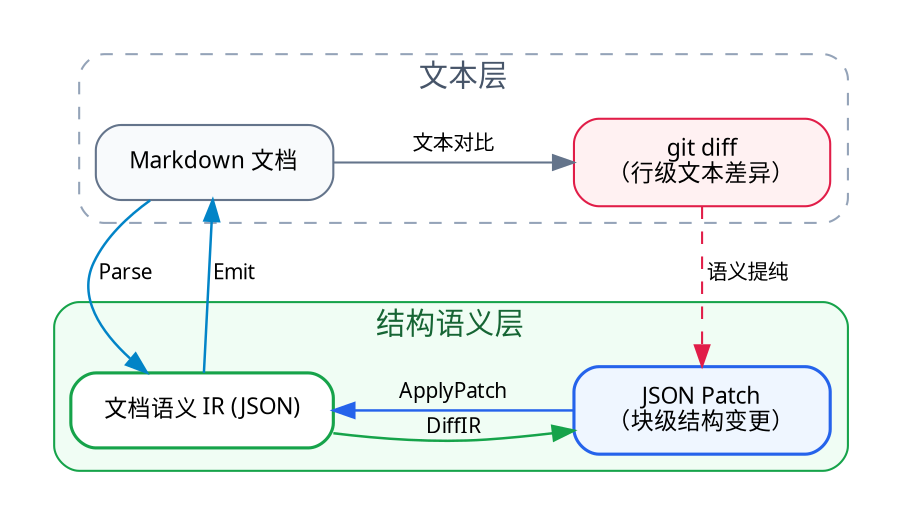

# Markdown 语义 IR 规范（`markdown-ir`）

背景与目标：Markdown 文档的修改在文本层通常由 `git diff` 表达，但基于行的文本 diff 缺乏文档结构语义（无法区分纯排版噪音与真实语义修改，也无法表达“移动某个列表项”“修改某级标题属性”等结构操作）。为此，我们设计一套引擎无关、支持多 Markdown 方言扩展的「Markdown 语义 IR」并用 JSON 表示；借此将静态的 Markdown 文档映射为结构化 JSON 树，进而用「JSON Patch」精确表达与操作 Markdown 改动的结构语义，实现全量与增量的双向无损同步。

## 1. 总体需求与核心不变量

### 1.1 核心推导逻辑与双向链路

整个系统的设计源于从「文本层」到「结构语义层」的对偶推导：

1. 痛点（`git diff` 语义不足）：人在修改 Markdown 时，文本层只能产生基于行的 `git diff`。无论是增删空行、列表符号从 `*` 改为 `-`，还是移动整段章节，在 `git diff` 中都只是扁平的文本行增删，缺少“改了哪个文档块、做了什么结构变更”的语义。
2. 静态结构化（`Markdown ⇄ IR JSON`）：为了补齐结构语义，我们将 Markdown 解析映射为引擎无关的文档语义 IR，并以 JSON 树承载（每个块级节点拥有稳定 `id` 与固定字段外壳）。
3. 动态变更结构化（`git diff ⇄ JSON Patch`）：一旦文档由 IR JSON 表示，文档的修改就自然转化为 IR 树上的 JSON Patch——既能从人改前后的 Markdown 中提纯出无排版噪音的结构化 JSON Patch，也能直接把 JSON Patch 应用到 IR 上并写回 Markdown。



系统围绕这两层建立两条双向链路：

- 全量双向链路（静态文档互转，`Markdown ⇄ IR JSON`）：
  - 正向（`IR → Markdown`）：合法规范的文档语义 IR 经 `Adapter.Emit`（阶段 2）渲染为规范风格的 Markdown 文本，默认保持纯净规范 Markdown（配合隐藏 `IR_old` 快照无感继承块身份，仅按需在关键块显式落盘锚点）供人阅读和编辑。
  - 反向（`Markdown → IR`）：人修改 Markdown（改字、调整结构、新增段落、手写任意 Markdown 语法）后，经 `Adapter.Parse`（阶段 2）解析并剥离底层引擎私有 AST、还原块 `id`，再由阶段 1 内核 `Normalize` / `Verify` 产出标准语义 IR。
- 增量双向链路（动态改动互转，`git diff ⇄ JSON Patch`）：
  - 人改 Markdown → 提取 JSON Patch：`DiffIR(IR_old, IR_new)` 在 IR 层对比编辑前后的文档树，过滤空行/缩进等纯排版噪音，将原本粗糙的文本 `git diff` 提纯为基于块 `id` 寻址的 JSON Patch。
  - 应用 JSON Patch → 局部更新 Markdown：`ApplyPatch(IR_old, Patch)` 在 IR 树上直接执行块级增删改移补丁，并支持按源码区间 `pos` 局部重印 Markdown。

### 1.2 全链路上的模块

1. 纯 IR 校验、规范化与升级内核（`ir`）
   - 输入 → 输出：`任意 IR JSON` → `合法规范化 IR / Error`
   - 核心职责：定义 IR 数据结构、版本升级（`AutoUpgrade`）、schema 与嵌套约束校验（`Verify`）、相邻文本合并等规范化（`Normalize`）
2. Markdown → IR 解析器（`Parse`）
   - 输入 → 输出：`Markdown (+ 可选 IR_old)` → `IR + Diagnostics`
   - 核心职责：解析 Markdown、剥离引擎私有结构、绑定块 `id`、捕获超纲构造进 `raw_*`
3. IR → Markdown 生成器（`Emit`）
   - 输入 → 输出：`IR` → `Markdown`
   - 核心职责：按规范形式写出 Markdown 文本；默认保持纯净规范 Markdown（配合隐藏 `IR_old` 快照无感继承块身份），仅按需在关键块显式落盘身份锚点
4. IR 差分生成器（`DiffIR`）
   - 输入 → 输出：`(IR_old, IR_new)` → `Patch`
   - 核心职责：将修改 Markdown 产生的新旧 IR 状态提纯为结构化 Patch，过滤纯排版噪音
5. IR 补丁应用器（`ApplyPatch`）
   - 输入 → 输出：`IR_old + Patch` → `IR_new (+ Markdown)`
   - 核心职责：在 IR 上执行增删改移补丁，支持局部更新 Markdown

### 1.3 不变量

1. 一圈幂等（Idempotence）：对任意合法 IR `x`，若人不介入编辑，则 `emit(parse(emit(x))) == emit(x)`，且 `normalize(parse(emit(x))) == normalize(x)`。
2. 身份存活（Identity Preservation）：修改某块的文本或移动块位置不应改变该块的 `id`；新增块应能被识别为无原身份的新块。
3. 无静默丢失（No Silent Loss）：人手写的超纲 Markdown 构造，或高版本/未启用方言中的未知节点与属性，回读和保存时不得被静默丢弃——必须装入逃生舱节点或属性字典原样保留。
4. 引擎无关（Engine Agnosticism）：IR 数据结构中不得出现任何特定 Markdown 引擎的私有概念；切换底层引擎不修改 IR 数据定义。
5. 方言可扩展（Dialect Extensibility）：以 CommonMark 作为基础公共核，支持按需注册并扩展各类 Markdown 方言（如 GFM、数学公式、双链笔记、Callout/容器指令等）的块级与行内节点；扩展新方言不改变 `Node` 物理外壳，且支持跨方言 `fallback` 降级与 `raw_*` 保底。

## 2. 架构分层

借鉴编译器（LLVM / MLIR）以 IR 为中心与多方言（Dialect）的设计思想，系统将「纯 IR 数据结构、方言扩展机制与校验规范化规则（内圈核心）」与「具体的 Markdown 解析引擎及增量工具（外圈适配）」解耦，按由内向外的顺序分为三个阶段推进。

目前我们只针对「阶段 1：纯 IR 数据定义」完成了具体深入的讨论与设计定稿；阶段 2～3 尚未经过深入讨论，当前仅保留前期粗浅调研的方向性构想，留待阶段 1 落地后再逐阶段展开具体设计：

1. 阶段 1（内圈）：纯 IR 数据结构定义与内核规则（见 §2.1）
   - 定位与范围：完全不感知具体 Markdown 解析引擎的语法细节；定义节点物理外壳、根节点 `"markdown-ir"` 版本头、基础核节点与方言（Dialect）扩展机制、块 `id` 归属边界、以及纯 IR 树的校验（`Verify`）、规范化（`Normalize`）与版本升级（`AutoUpgrade`）。
   - 当前设计成熟度：✅ 已完成具体设计并锁定（可直接进入编码实现）。
2. 阶段 2（外圈）：Markdown 引擎适配与文本转换（见 §2.2）
   - 定位与范围：将 lute、goldmark 等作为可替换适配器站在外圈，负责 `Parse` / `Emit`、各 Markdown 方言语法与 IR 节点的双向映射、Markdown 文本中 `{: id="..."}` 与 `meta` 的落点细节、转义与格式化规则。
   - 当前设计成熟度：📝 仅完成前期粗浅调研（方向初探，尚未具体讨论定稿）。
3. 阶段 3（外圈）：增量 Diff / Patch 算子（见 §2.3）
   - 定位与范围：在 IR 层实现 `DiffIR` / `ApplyPatch`、ID 寻址补丁具体结构、以及按 `pos` 局部重印策略。
   - 当前设计成熟度：📝 仅完成前期粗浅调研（方向初探，尚未具体讨论定稿）。

---

### 2.1 纯 IR 数据结构规范

#### 2.1.1 节点物理外壳（Node Envelope）—— MLIR `Operation` 式固定结构

设计决策：固定顶层槽位 + `attrs` 开放字典

节点专有属性（如标题的 `depth`、链接的 `url`、列表的 `ordered`）不散落在节点顶层，而是统一收敛进 `attrs` 字典。整棵 IR 树中的任何节点永远只使用以下固定的顶层系统键：

```json
{
  "markdown-ir": "0.0.1",
  "id": "20261029-doc01",
  "type": "doc",
  "meta": {},
  "children": [ ... ]
}
```

Go 核心结构体定义：

```go
type Node struct {
    Version  string         `json:"markdown-ir,omitempty"` // 仅根节点 type=="doc" 必填，格式魔数兼 SemVer 版本号，如 "0.0.1"
    ID       string         `json:"id,omitempty"`          // 块级节点稳定身份（行内节点禁止出现）
    Type     string         `json:"type"`                  // 节点类型操作码
    Attrs    map[string]any `json:"attrs,omitempty"`       // 节点固有语法属性（Inherent Attrs，由 Verifier 按 Type 校验）
    Value    *string        `json:"value,omitempty"`       // 叶子节点纯文本载荷（仅 text / inline_code / code_block / raw_*）
    Children []*Node        `json:"children,omitempty"`    // 容器节点的有序子节点列表（Regions）
    Meta     map[string]any `json:"meta,omitempty"`        // 附加旁路元数据（Discardable Attrs，跨 Pass 强制透传）
    Fallback []*Node        `json:"fallback,omitempty"`    // 扩展节点或高版本未知节点的降级渲染子树
    Pos      *SourcePos     `json:"pos,omitempty"`         // 可选源码区间 {start, end, lines}，持久化可省略
    Origin   *SourceOrigin  `json:"origin,omitempty"`      // 可选源保真旁路数据，持久化可省略
    Errors   []Diagnostic   `json:"errors,omitempty"`      // 节点级解析/校验诊断信息
}
```

决策原因：
1. 吸收 LLVM 历史教训与 MLIR 终局抽象：早期 LLVM 因将属性写死为固定位掩码、未预留旁路元数据槽，在 LLVM 2.7（补 `Metadata`）、3.3（属性改开放字典 `AttributeList`）、14–17（Opaque Pointers 剥离指针类型外壳）经历了三次底层结构大手术。MLIR 总结该教训后将节点固定为 `{名称, 属性字典, 值, 嵌套区域, 源码位置}` 五元组，此后新增任何方言与语法均只扩展属性字典键值，永不动摇节点外壳。
2. 根治 Go `encoding/json` 静默丢字段隐患：若将节点专有属性平铺在顶层，旧版程序反序列化新版包含新顶层字段的 JSON 时，Go 标准库会静默丢弃未定义字段，违反不变量 #3（无静默丢失）。收敛入 `Attrs: map[string]any` 后，配合顶层 `DisallowUnknownFields()`，既能严格拦截顶层拼写错误，又能无损保留未知属性。
3. `attrs` 与 `meta` 职责正交（对应 MLIR Inherent vs Discardable Attributes）：
   - `attrs`：存放定义节点自身文档语义的固有参数（由 `Verify` 按 `type` 严格校验 schema），如 `depth`、`url`、`ordered` 及 `x-*` 扩展块的结构化参数。
   - `meta`：存放不影响文档核心语法结构的附加自定义属性（如块级自定义标签、注释标记、外部引用属性等），值类型限定为 `string | number | boolean | string[]`。未知 `meta` 键必须跨所有转换 Pass 原样透传保留。
   - 系统保留键规范：键名 `markdown-ir`、`id`、`type`、`attrs`、`value`、`children`、`meta`、`fallback`、`pos`、`origin`、`errors` 及前缀 `_`、`sys:` 归系统保留，禁止写入 `meta`。
4. 顶层 `"markdown-ir": "0.0.1"` 格式头（对齐 OpenAPI / LLVM Module Header）：将协议标识与三段式语义化版本（`MAJOR.MINOR.PATCH`）合二为一置于根对象顶层，使加载器 `LoadIR` 在反序列化整棵树之前即可常数时间识别格式并路由至 `AutoUpgrade` 迁移链。

#### 2.1.2 节点身份（`id`）在数据结构上的归属边界

直接对齐 `./lute/parse/parse.go:54`（`finalParseBlockIAL`）与 `./lute/ast/node.go:948`（`IsBlock()`）的边界规则：

- 持有全局唯一 `id` 的节点：
  全部块级节点（Block Nodes，含 `doc` 与 `list_item`，以及 GFM 方言中的 `table`）。
- 严格禁止携带 `id`（`id` 必须为空）的节点：
  全部行内节点（Inline Nodes），以及 GFM 表格内部的 `table_row` 与 `table_cell`（在 Lute `IsBlock()` 中同样为 `false`）。

决策原因：
`list_item` 是独立的块级结构容器（内部可包含多个段落或嵌套子列表）。在文档增量编辑中移动、重排、增删单个列表项时，只有让 `list_item` 自身持有独立 `id`，`DiffIR` / `ApplyPatch` 才能精确识别并寻址到具体的列表项。同时这一边界与 Lute 引擎源码的 `IsBlock()` 定义 100% 一致。

#### 2.1.3 标准节点指令集与合法性约束（Instruction Reference）

决策：首版（`0.0.1`）锁定 CommonMark 基础公共核 + 逃生舱 + 方言扩展机制，GFM 等具体方言通过方言机制渐进合入

- `0.0.1`（首版基础核）：收录 CommonMark 0.31.2 完整基础语义 + 逃生舱（`raw_block`/`raw_inline`）+ 方言扩展节点（块级与行内 `x-<dialect>/<op>`），作为所有 Markdown 方言共享的最大公约数底座。
- `0.1.0+`（后续方言扩展版本）：以方言模块形式渐进扩充 GFM（`table` / `table_row` / `table_cell`、`delete` 删除线、`list_item.attrs.checked` 任务列表）、数学公式（`math`）、脚注（`footnote`）、双链与 Callout（`obsidian` / `siyuan`）等方言。在尚未开启对应方言时，超纲语法先无损装入 `raw_block` / `raw_inline`，开启方言后通过 `AutoUpgrade` 或方言 Pass 自动升格为结构化节点。

*(注：CommonMark 中的 HTML 块/行内 HTML 直接归入 `raw_block`/`raw_inline`（`format: "html"`），链接引用定义 `[ref]: /url` 在解析规范化时直接展开归并入 `link`/`image`，不设冗余节点类型。)*

（1）块级节点（Block Nodes，10 类，均持有块 `id`）

| `type` | `attrs` 字段定义（类型与默认值） | `value` 约束 | `children` 约束（Content Model） | 对应语义 |
|---|---|---|---|---|
| `doc` | 无（根顶层带 `"markdown-ir": "0.0.1"`） | 禁止（`nil`） | `Block[]`（禁止含 `doc`、`list_item`） | 文档唯一根节点 |
| `heading` | `depth`: `int`（`1..6`，必填） | 禁止 | `Inline[]` | 标题（不区分 ATX/Setext） |
| `paragraph` | 无 | 禁止 | `Inline[]` | 段落 |
| `code_block` | `lang?`: `string`, `info?`: `string`（空串默认省略） | `string`（必填） | 禁止 | 代码块（不区分缩进/围栏） |
| `blockquote` | 无 | 禁止 | `Block[]`（禁止含 `doc`、`list_item`） | 引用容器块 |
| `list` | `ordered?`: `bool`（默认 `false`）<br>`start?`: `int`（默认 `1`）<br>`tight?`: `bool`（默认 `true`） | 禁止 | `list_item[]`（至少 1 个，仅限 `list_item`） | 有序/无序列表容器 |
| `list_item` | 无（GFM 方言扩展 `checked?: bool`） | 禁止 | `Block[]`（禁止含 `doc`、`list_item`） | 列表项（父节点只能是 `list`） |
| `thematic_break` | 无 | 禁止 | 禁止 | 分割线 |
| `raw_block` | `format`: `string`（必填：`"markdown"` \| `"html"` \| `"ir-unknown"` \| `"invalid-x-node"`） | `string`（必填） | 禁止 | 块级无损逃生舱 |
| `x-<dialect>/<op>` | 任意合法 JSON 对象（由对应方言 Schema 校验） | 可选 | 可选（可带 `fallback: Block[]`） | 块级方言扩展节点（名称匹配 `^x-[a-z0-9-]+/[a-z0-9-]+$`） |

（2）行内节点（Inline Nodes，9 类，禁止持有 `id`）

| `type` | `attrs` 字段定义（类型与默认值） | `value` 约束 | `children` 约束（Content Model） | 对应语义 |
|---|---|---|---|---|
| `text` | 无 | `string`（必填，规范化后非空） | 禁止 | 纯文本（已解码实体） |
| `strong` | 无 | 禁止 | `Inline[]`（至少 1 个） | 强强调（加粗） |
| `emphasis` | 无 | 禁止 | `Inline[]`（至少 1 个） | 强调（斜体） |
| `inline_code` | 无 | `string`（必填） | 禁止 | 行内代码 |
| `link` | `url`: `string`（必填）<br>`title?`: `string`（默认省略） | 禁止 | `Inline[]`（后代中禁止嵌套 `link`） | 超链接 |
| `image` | `url`: `string`（必填）<br>`alt`: `string`（必填，允许 `""`）<br>`title?`: `string`（默认省略） | 禁止 | 禁止（`alt` 拍平为纯文本属性，对齐 Lute 与 MDAST） | 图片 |
| `break` | `hard?`: `bool`（默认 `false` 软换行，`true` 硬换行） | 禁止 | 禁止 | 软换行 / 硬换行 |
| `raw_inline` | `format`: `string`（必填：`"markdown"` \| `"html"` \| `"ir-unknown"`） | `string`（必填） | 禁止 | 行内无损逃生舱 |
| `x-<dialect>/<op>` | 任意合法 JSON 对象（由对应方言 Schema 校验） | 可选 | 可选（可带 `fallback: Inline[]`） | 行内方言扩展节点（如行内公式、双链、高亮等） |

#### 2.1.4 Markdown 方言扩展机制（Dialect Architecture）

真实世界中的 Markdown 存在众多方言（如 GFM、Obsidian/思源双链笔记、Pandoc/Quarto 学术写作、MDX/Markdoc 组件指令等）。借鉴 MLIR 的 Dialect（多方言共存）机制，IR 从内核层原生支持方言扩展：

1. 外壳不变，指令可扩展：
   由于 `Node` 物理外壳固定为 `{id, type, attrs, value, children, meta, fallback}`，新增任何 Markdown 方言均不修改 `Node` 结构体，仅需在命名空间 `<dialect>/<op>`（自定义方言使用 `x-<dialect>/<op>`）下定义新节点的 `type` 及其 `attrs` / `children` 约束。
2. 典型 Markdown 方言映射规划：
   - GFM 方言：表格（`table` / `table_row` / `table_cell`）、任务列表（`list_item.attrs.checked`）、删除线（`delete`）、GitHub Alert（`x-gfm/alert`）。
   - 数学与学术方言（Math & Footnote）：块级公式（`x-math/block`，承载 `$$...$$`）、行内公式（`x-math/inline`，承载 `$...$`）、脚注定义与引用（`x-footnote/def`、`x-footnote/ref`）。
   - 双链与知识库方言（Obsidian / 思源）：双向链接（`x-wiki/link`，承载 `[[Page|Alias]]`）、块嵌入（`x-wiki/embed`，承载 `![[...]]` / `((id))`）、Callout 容器块（`x-callout/block`）、文本高亮（`x-mark/highlight`，承载 `==...==`）。
3. 方言注册表（`DialectRegistry`）：
   阶段 1 的 `Verify` 与 `Normalize` 不将节点集合写死为封闭分支，而是支持挂载 `DialectSpec`（声明该方言节点的块/行内归属、`attrs` 字段类型与默认值、允许的 `children` 嵌套类型）。对于已注册的方言节点，按其 Schema 严格校验；对于未注册的 `x-<dialect>/<op>` 节点，校验其基本外壳与 `fallback` 合法性并原样放行。
4. 跨方言无损降级与升格（Graceful Fallback & Promotion）：
   - 向低能力方言降级（`fallback`）：方言节点可携带由基础 CommonMark 节点构成的 `fallback` 子树（例如 `x-wiki/link` 的 `fallback` 为普通 `text` 或标准 `link`），当导出目标不支持该方言时可平滑降级渲染，或输出受控代码块保真。
   - 从未识别语法升格（`raw_* → 方言节点`）：当解析器未开启某方言时，对应语法先无损存入 `raw_block` / `raw_inline`；后续开启该方言时，可通过方言升级 Pass 将其解析升格为强类型方言节点。

#### 2.1.5 纯 IR 树自身的规范化、校验与版本演进规则（Stage 1 内核逻辑）

1. 纯 IR 规范化流水线（`Normalize(doc)`）：
   实现为显式有序的纯函数小 Pass 序列，必须满足收敛性合同 `Normalize(Normalize(x)) == Normalize(x)`：
   - Pass 1（换行归一化）：统一所有 `value` 内的 `\r\n` / `\r` 为 `\n`。
   - Pass 2（文本归并与空节点清理）：删除 `value == ""` 的空 `text` 节点；合并同一父节点下连续相邻的 `text` 兄弟节点。
   - Pass 3（默认值属性剥离）：剥离 `attrs` 中等于默认值的可选字段（如 `list` 的 `ordered:false, start:1, tight:true`；`break` 的 `hard:false`；空 `title` / `lang` / `info` 以及已注册方言的默认属性），空字典置 `nil`。
2. 双端合法性校验器（`Verify(doc)`）：
   强制校验根信封 `"markdown-ir"` 版本号、块级 `id` 全局唯一性与行内禁 `id`、基础核与已注册方言节点的 `attrs` / `value` / `children` Content Model（含 `link` 禁嵌 `link`、`list` 仅含 `list_item`）、以及 `meta` 系统保留键冲突。
3. 版本升级与前向兼容（`LoadIR` & `AutoUpgrade`）：
   - 向后兼容（旧数据 → 新代码）：入口预检顶层 `"markdown-ir"` 版本号（`MAJOR.MINOR.PATCH`），若低于当前版本，按有序迁移链 `migrations[v -> v_next]` 自动升级 JSON 树。
   - 前向兼容（新数据 → 旧代码）：若遇到同大版本（`MAJOR` 相同）更高小版本中不认识的节点类型，保留其 `fallback` 并将原节点完整 JSON 封入 `raw_block`/`raw_inline`（`attrs: {"format": "ir-unknown"}`），确保写回时不丢失未来版本数据；遇到跨大版本则明确报错拒绝。
   - 版本金样固化：每版本冻结一份覆盖全部节点的 `compatibility-0.0.1.json`，纳入后续版本回归门禁。

#### 2.1.6 完整 JSON 示例

```json
{
  "markdown-ir": "0.0.1",
  "id": "20261029-doc01",
  "type": "doc",
  "children": [
    {
      "id": "20261029-aaaa",
      "type": "heading",
      "attrs": { "depth": 1 },
      "children": [
        { "type": "text", "value": "搜索服务重构评审" }
      ]
    },
    {
      "id": "20261029-bbbb",
      "type": "paragraph",
      "children": [
        { "type": "text", "value": "目标是将核心接口延迟降低 " },
        { "type": "strong", "children": [{ "type": "text", "value": "30%" }] },
        { "type": "text", "value": "，详见 " },
        {
          "type": "x-wiki/link",
          "attrs": { "target": "延迟优化方案", "alias": "优化方案" },
          "fallback": [{ "type": "text", "value": "[[延迟优化方案|优化方案]]" }]
        },
        { "type": "text", "value": "。" }
      ]
    },
    {
      "id": "20261029-cccc",
      "type": "list",
      "children": [
        {
          "id": "20261029-li01",
          "type": "list_item",
          "children": [
            {
              "id": "20261029-p001",
              "type": "paragraph",
              "children": [{ "type": "text", "value": "完成纯 IR 内核" }]
            }
          ]
        }
      ]
    },
    {
      "id": "20261029-dddd",
      "type": "x-callout/block",
      "attrs": { "kind": "note", "title": "注意" },
      "children": [
        {
          "id": "20261029-p002",
          "type": "paragraph",
          "children": [{ "type": "text", "value": "请先完成阶段 1 校验。" }]
        }
      ],
      "fallback": [
        {
          "id": "20261029-fb01",
          "type": "blockquote",
          "children": [
            {
              "id": "20261029-fb02",
              "type": "paragraph",
              "children": [{ "type": "text", "value": "注意：请先完成阶段 1 校验。" }]
            }
          ]
        }
      ]
    }
  ]
}
```

### 2.2 【前期调研构想 · 待深入设计】Markdown 引擎适配与文本转换

> ⚠️ 注意：以下 §2.2 与 §2.3 内容属于前期调研形成的高层方向性草案，尚未像 §2.1 那样经过逐项深入讨论与细节锁定。在阶段 1（纯 IR 内核）完成后，进入对应阶段前需重新展开具体设计评审。

#### 2.2.1 Markdown 文本中的身份锚点与属性表现

- 初步方向：磁盘上的 `.md` 文件默认保持对人类与通用 Agent 100% 友好的纯净规范格式（零视觉污染，不在段落、列表项等普通块上强行写入 `{: id="..."}`）；仅在关键章节标题或特殊 `x-*` 扩展容器块上允许按需显式落盘可选锚点（复用 Lute 原生的 Kramdown Block IAL）。块身份与 `meta` 的常规存活路径改为「旁路快照对齐 + 按需稀疏锚点」：在隐藏元数据区（如 `.git/info/`、同目录隐藏快照文件或数据库）保存上一版本的 `IR_old` JSON，`Parse(Markdown, IR_old)` 通过确定性的树结构与文本指纹对齐算法（参考 mdd `identity.reattach` 的分级匹配——显式锚点优先 → 章节子树 + 文本 SHA-256 指纹精确匹配 → 同父容器下结构位置确定性继承，不做跨结构的不可靠模糊乱猜）在后台自动将 `IR_old` 中的块 `id` 与 `meta` 无感继承给未重构的块，既保住不变量 #2（块身份存活），又实现 `.md` 源码层的零视觉污染（并保留无锚点的 `stateless` 模式供简单导入导出场景使用）。
- 待深入讨论的细节：
  - 确定性树结构与文本指纹对齐的分级匹配规则（显式锚点 → 章节子树 + 文本 SHA-256 指纹 → 同父结构位置继承，各级之间的优先级、加分与短路条件）；
  - 隐藏快照 `IR_old` 的存储落点约定（`.git/info/` vs 同目录隐藏快照文件 vs 数据库，快照与 `.md` 的版本绑定与失效策略；节点 `meta` 与文档级 `doc.meta` 默认随旁路恢复，是否仍需 YAML Frontmatter 承载文档级元数据）；
  - 哪些关键块（如章节标题、特殊 `x-*` 扩展容器块）允许显式落盘可选锚点（含 `{: id="..."}` 写出的精确格式与缩进规则），以及复制粘贴产生重复 ID（`ambiguous`）或手动删改锚点（`unanchored`）时的具体消歧策略。

#### 2.2.2 Markdown 规范化输出（Canonical Emission）与转义

- 初步方向：`Emit` 渲染 Markdown 时应遵循唯一规范形式（如统一用 ATX `#` 标题、`- ` 无序列表、动态长度反引号围栏、`proseWrap: preserve` 保留段落折行、最小化上下文敏感转义），以保证 `emit(parse(emit(x))) == emit(x)`。
- 待深入讨论的细节：
  - `Emit` 是直接基于 IR 树编写独立的公共 Printer，还是复用 Lute 的 `FormatNodeSync`（在适配器中补齐 Marker 节点）；
  - `normalising`（强制规范化输出）与 `preserving`（未修改块按 `origin.raw_bytes` 原样回放）两种模式的切换边界。

#### 2.2.3 方言语法适配与逃生舱表现

- 初步方向：
  - 方言插件化转换：外圈引擎适配器根据启用的方言列表，将原生方言语法（如 GFM 表格、`$...$` 数学公式、`[[...]]` 双链、`> [!NOTE]` Callout）与对应 IR 方言节点双向互转；
  - Markdown → IR 逃生舱兜底：遇到未开启方言的语法或局部语法错误时，不整篇崩溃，而是截取源码装入 `raw_block`/`raw_inline` 原样保留，并发出 `fallback_emitted` 诊断；
  - IR → Markdown 跨方言降级：当目标 Markdown 方言不支持某扩展节点时，可选择写出受控围栏代码块（无损模式）或渲染节点的 `fallback` 子树（兼容降级模式）。
- 待深入讨论的细节：
  - 各常见方言（GFM、Math、Obsidian/思源）在 Lute / Goldmark 适配器中的具体语法映射表；
  - 受控围栏代码块中 `attrs` JSON 的格式化方式与损坏兜底（`invalid-x-node`）恢复策略。

---

### 2.3 【前期调研构想 · 待深入设计】增量 Diff / Patch 算子

- 初步方向：结构化 diff 在 IR 树层完成以过滤纯排版噪音；为避免标准 RFC 6902 数组下标（`/children/3`）在前方插入块时发生整体漂移，设想引入基于块 `@id` 的寻址补丁并与 RFC 6902 互转；在反向应用补丁时探索基于 `pos` 的局部重印（recast 模式）。
- 待深入讨论的细节：
  - ID 寻址 Patch 的精确数据结构定义（`add` / `remove` / `replace` / `move` 的锚点字段与冲突处理）；
  - 局部字节替换在跨块边界（如列表缩进、空行分隔）上的安全性与回退条件。

## 3. 候选引擎摸底

1. lute（`./lute`）
   - 定位：面向编辑器（思源/Vditor）的结构化引擎，Mulan PSL v2
   - 规范覆盖：CommonMark + GFM + Kramdown IAL
   - AST 形态：单一 `ast.Node` struct + `NodeType` 枚举
   - 原文保真方式：Marker 入树——`# `、`**` 作为独立子节点存在于 AST 中
   - 块身份与属性机制：原生支持 Kramdown Block IAL（`{: id="..." k="v"}`）双向解析与写回
2. goldmark v2（`./goldmark`）
   - 定位：通用解析组件库，零依赖，MIT
   - 规范覆盖：CommonMark 0.31.2（100%）+ GFM
   - AST 形态：`ast.Node` 接口 + 强类型 struct
   - 原文保真方式：CST 切片——节点引用源码字节区间
   - 块身份与属性机制：仅 ATX 标题支持 Pandoc 式 `{#id .class}`，块级通用属性需扩展
3. markdown-it（`15.0.3` 参照）
   - 定位：JS 生态通用解析器（单向渲染）
   - 规范覆盖：CommonMark + 插件体系
   - AST 形态：扁平 `Token[]` 流
   - 原文保真方式：仅保留源码行号 `map: [lineStart, lineEnd]`
   - 块身份与属性机制：核心不支持；社区插件仅支持单向转 HTML

## 4. 参考调研
1. [解析引擎横向调研](../RESEARCH-markdown-rst-parsing-engines.md)
2. [JSON↔Markdown 无损同步先例调研](../RESEARCH-md-json-lossless-sync.md)
3. [≥5k★ 生态扫描与 LLVM/MLIR 纪律移植分析](../RESEARCH-markdown-5k-projects-and-llvm-ir.md)
